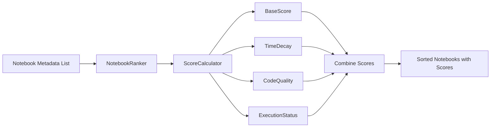

# Design Document: Enhanced Notebook Ranking

## Overview

The Enhanced Notebook Ranking system replaces the current simple upvote-based ranking with a sophisticated multi-signal algorithm. The design introduces a modular scoring system that combines upvote count, time decay, code quality metrics, and execution status to produce a comprehensive ranking score.

The system is designed to be:
- **Extensible**: New quality signals can be added without restructuring
- **Configurable**: Weights and thresholds adjustable via configuration
- **Transparent**: All scoring factors exposed in output
- **Backward Compatible**: Works with existing cached data

## Architecture

### Component Structure

```
NotebookRanker (New)
├── ScoreCalculator
│   ├── BaseScoreCalculator (upvotes)
│   ├── TimeDecayCalculator
│   ├── CodeQualityCalculator
│   └── ExecutionStatusCalculator
├── RankingConfig (Configuration loader)
└── RankingMetadata (Score breakdown)

NotebookService (Modified)
└── Uses NotebookRanker instead of _rank_notebooks
```

### Data Flow



### Integration Points

1. **NotebookService**: Replace `_rank_notebooks()` method to use new `NotebookRanker`
2. **TOON Encoder**: Extend to include ranking metadata in output
3. **Configuration**: Add `ranking_config.json` or environment variables for weights
4. **Database Schema**: Optional extension to cache ranking scores

## Components and Interfaces

### 1. NotebookRanker

Main orchestrator for the ranking system.

```python
class NotebookRanker:
    """
    Ranks notebooks using multiple quality signals.
    """

    def __init__(self, config: RankingConfig | None = None):
        """
        Initialize ranker with optional configuration.

        Args:
            config: Configuration object with weights and thresholds
""
        self.config = config or RankingConfig.default()
        self.score_calculator = ScoreCalculator(self.config)

    def rank_notebooks(
        self,
        notebooks: list[NotebookMeta],
        processed_content: dict[str, NotebookContent] | None = None
    ) -> list[tuple[NotebookMeta, RankingMetadata]]:
        """
        Rank notebooks by computing multi-signal scores.

        Args:
            notebooks: List of notebook metadata objects
            processed_content: Optional dict mapping ref to parsed content

        Returns:
            List of (notebook, ranking_metadata) tuples sorted by score
        """
        pass
```

### 2. ScoreCalculator

Computes individual scoring components and combines them.

```python
class ScoreCalculator:
    """
    Calculates ranking scores from multiple signals.
    """

    def __init__(self, config: RankingConfig):
        self.config = config
        self.base_calculator = BaseScoreCalculator()
        self.time_decay_calculator = TimeDecayCalculator(config)
        self.code_quality_calculator = CodeQualityCalculator(config)
        self.execution_calculator = ExecutionStatusCalculator(config)

    def calculate_score(
        self,
        notebook: NotebookMeta,
        content: NotebookContent | None = None
    ) -> tuple[float, RankingMetadata]:
        """
        Calculate final ranking score and metadata.

        Args:
            notebook: Notebook metadata
            content: Optional parsed notebook content

        Returns:
            Tuple of (final_score, metadata_breakdown)
        """
        pass
```

### 3. Individual Calculators

#### BaseScoreCalculator

```python
class BaseScoreCalculator:
    """
    Computes base score from upvote count using logarithmic scaling.
    """

    def calculate(self, upvotes: int) -> float:
        """
        Compute base score: log10(upvotes + 1) * 10

        Args:
            upvotes: Number of upvotes

        Returns:
            Base score (0-40 range for typical upvote counts)
        """
        pass
```

#### TimeDecayCalculator

```python
class TimeDecayCalculator:
    """
    Applies time-based decay to prioritize recent notebooks.
    """

    def __init__(self, config: RankingConfig):
        self.no_decay_days = config.no_decay_days  # Default: 30
        self.full_decay_days = config.full_decay_days  # Default: 180
        self.min_decay_factor = config.min_decay_factor  # Default: 0.5

    def calculate(self, last_updated: str | None) -> float:
        """
        Calculate time decay factor.

        Args:
            last_updated: ISO timestamp or None

        Returns:
            Decay factor (0.5 to 1.0)
        """
        pass
```

#### CodeQualityCalculator

```python
class CodeQualityCalculator:
    """
    Scores notebooks based on code quantity and documentation balance.
    """

    def __init__(self, config: RankingConfig):
        self.min_code_cells = config.min_code_cells  # Default: 5
        self.min_code_ratio = config.min_code_ratio  # Default: 0.3
        self.low_code_penalty = config.low_code_penalty  # Default: 0.7
        self.low_ratio_penalty = config.low_ratio_penalty  # Default: 0.8

    def calculate(self, content: NotebookContent | None) -> float:
        """
        Calculate code quality factor.

        Args:
            content: Parsed notebook content

        Returns:
            Quality factor (0.56 to 1.0)
        """
        pass
```

#### ExecutionStatusCalculator

```python
class ExecutionStatusCalculator:
    """
    Adjusts score based on notebook execution success.
    """

    def __init__(self, config: RankingConfig):
        self.success_boost = config.success_boost  # Default: 1.2
        self.failure_penalty = config.failure_penalty  # Default: 0.6

    def calculate(self, notebook: NotebookMeta) -> float:
        """
        Calculate execution status factor.

        Args:
            notebook: Notebook metadata with optional execution status

        Returns:
            Status factor (0.6, 1.0, or 1.2)
        """
        pass
```

### 4. Configuration

```python
@dataclass
class RankingConfig:
    """
    Configuration for ranking algorithm.
    """
    # Time decay parameters
    no_decay_days: int = 30
    full_decay_days: int = 180
    min_decay_factor: float = 0.5

    # Code quality parameters
    min_code_cells: int = 5
    min_code_ratio: float = 0.3
    low_code_penalty: float = 0.7
    low_ratio_penalty: float = 0.8

    # Execution status parameters
    success_boost: float = 1.2
    failure_penalty: float = 0.6

    @classmethod
    def default(cls) -> "RankingConfig":
        """Return default configuration."""
        return cls()

    @classmethod
    def from_env(cls) -> "RankingConfig":
        """Load configuration from environment variables."""
        pass

    @classmethod
    def from_file(cls, path: str) -> "RankingConfig":
        """Load configuration from JSON file."""
        pass
```

### 5. Ranking Metadata

```python
@dataclass
class RankingMetadata:
    """
    Breakdown of ranking score components.
    """
    final_score: float
    base_score: float
    time_decay_factor: float
    code_quality_factor: float
    execution_status_factor: float
    upvotes: int
    age_days: int | None
    code_cells: int | None
    markdown_cells: int | None
    execution_status: str | None

    def to_dict(self) -> dict:
        """Convert to dictionary for serialization."""
        pass
```

## Data Models

### Extended NotebookMeta

The existing `NotebookMeta` model already contains most required fields. We'll use it as-is and extract additional information from `NotebookContent` when available.

```python
# Existing model (no changes needed)
class NotebookMeta(BaseModel):
    ref: str
    title: str
    author: str
    upvotes: int
    url: str
    last_updated: str | None
    kernel_type: str | None
```

### NotebookContent

The existing `NotebookContent` model provides code and markdown cells:

```python
# Existing model (no changes needed)
class NotebookContent(BaseModel):
    markdown: list[str]
    code: list[str]
```

### Ranked Notebook Output

New structure for returning ranked notebooks with metadata:

```python
@dataclass
class RankedNotebook:
    """
    Notebook with ranking information.
    """
    notebook: NotebookMeta
    ranking: RankingMetadata
    rank: int  # Position in sorted list (1-indexed)
```

## Error Handling

### Missing Data Handling

1. **Missing last_updated**: Treat as 180 days old (apply full decay)
2. **Missing content**: Skip code quality calculation (factor = 1.0)
3. **Missing execution status**: No adjustment (factor = 1.0)
4. **Invalid upvotes**: Treat as 0

### Configuration Errors

1. **Invalid weights**: Log warning and use defaults
2. **Missing config file**: Use default configuration
3. **Invalid threshold values**: Validate and clamp to reasonable ranges

### Calculation Errors

1. **Division by zero**: Handle edge cases (e.g., zero markdown cells)
2. **Invalid timestamps**: Parse errors default to 180 days
3. **Negative scores**: Clamp to minimum of 0.0

## Testing Strategy

### Unit Tests

Test individual calculator components:
- `test_base_score_calculator_logarithmic_scaling()`
- `test_time_decay_recent_notebooks_no_penalty()`
- `test_time_decay_old_notebooks_minimum_factor()`
- `test_code_quality_low_code_cells_penalty()`
- `test_code_quality_low_ratio_penalty()`
- `test_execution_status_success_boost()`
- `test_execution_status_failure_penalty()`
- `test_config_loading_from_env()`
- `test_config_validation()`

### Integration Tests

Test complete ranking pipeline:
- `test_rank_notebooks_with_all_signals()`
- `test_rank_notebooks_missing_content()`
- `test_rank_notebooks_missing_timestamps()`
- `test_ranking_order_correctness()`
- `test_backward_compatibility_legacy_data()`

### Property-Based Tests

Property-based tests will be defined after prework analysis in the Correctness Properties section.


## Correctness Properties

A property is a characteristic or behavior that should hold true across all valid executions of a system - essentially, a formal statement about what the system should do. Properties serve as the bridge between human-readable specifications and machine-verifiable correctness guarantees.

### Property 1: Upvote Score Monotonicity

*For any* two notebooks with identical timestamps, code quality, and execution status, if notebook A has more upvotes than notebook B, then notebook A's ranking score should be higher than notebook B's ranking score.

**Validates: Requirements 1.1, 6.1**

### Property 2: Time Decay Monotonicity

*For any* two notebooks with identical upvotes, code quality, and execution status, if notebook A is more recent than notebook B, then notebook A's ranking score should be higher than or equal to notebook B's ranking score.

**Validates: Requirements 1.2, 6.2**

### Property 3: Recent Notebooks No Decay

*For any* notebook less than 30 days old, the time decay factor should equal 1.0.

**Validates: Requirements 2.1**

### Property 4: Linear Decay in Middle Range

*For any* notebook between 30 and 180 days old, the time decay factor should be between 0.5 and 1.0, and should decrease linearly with age.

**Validates: Requirements 2.2**

### Property 5: Old Notebooks Minimum Decay

*For any* notebook older than 180 days, the time decay factor should equal 0.5.

**Validates: Requirements 2.3**

### Property 6: Code Quality Penalty Application

*For any* notebook with fewer than 5 code cells, the code quality factor should be at most 0.7. *For any* notebook with code-to-markdown ratio below 0.3, the code quality factor should be at most 0.8.

**Validates: Requirements 3.3, 3.4**

### Property 7: Code Quality No Penalty

*For any* notebook with at least 5 code cells and code-to-markdown ratio of at least 0.3, the code quality factor should equal 1.0.

**Validates: Requirements 3.5**

### Property 8: Execution Status Boost

*For any* notebook with execution status "complete" or "success", the execution status factor should equal 1.2.

**Validates: Requirements 4.2**

### Property 9: Execution Status Penalty

*For any* notebook with execution status "error" or "failed", the execution status factor should equal 0.6.

**Validates: Requirements 4.3**

### Property 10: Score Composition

*For any* notebook, the final ranking score should equal the base score multiplied by the time decay factor, multiplied by the code quality factor, multiplied by the execution status factor.

**Validates: Requirements 1.5, 6.2, 6.3, 6.4**

### Property 11: Descending Sort Order

*For any* list of ranked notebooks returned by the ranker, each notebook's score should be greater than or equal to the next notebook's score.

**Validates: Requirements 6.5**

### Property 12: Configuration Validation

*For any* configuration with negative weight values, the ranker should either reject the configuration or clamp the values to positive numbers.

**Validates: Requirements 5.3**

### Property 13: Configuration Application

*For any* two ranking operations with different configurations, if the configurations have different penalty values, the resulting scores should differ for notebooks affected by those penalties.

**Validates: Requirements 5.5**

### Property 14: Output Completeness

*For any* ranked notebook in the output, the ranking metadata should include final_score, base_score, time_decay_factor, code_quality_factor, and execution_status_factor.

**Validates: Requirements 7.1, 7.2**

### Property 15: TOON Format Ranking Metadata

*For any* TOON-formatted output, the notebooks section should contain ranking score information for each notebook.

**Validates: Requirements 7.3**

### Property 16: JSON Format Ranking Details

*For any* JSON-formatted output, each notebook object should contain a ranking_details field with score breakdown.

**Validates: Requirements 7.4**

### Property 17: Graceful Missing Data Handling

*For any* notebook with missing last_updated, missing content, or missing execution status, the ranker should compute a score without raising exceptions.

**Validates: Requirements 8.1, 8.2, 8.3**

### Property 18: Missing Timestamp Default

*For any* notebook with missing or invalid last_updated timestamp, the time decay factor should equal 0.5 (treated as 180 days old).

**Validates: Requirements 2.4**

### Property 19: Missing Execution Status Default

*For any* notebook with missing execution status, the execution status factor should equal 1.0.

**Validates: Requirements 4.4**

### Property 20: Missing Content Default

*For any* notebook with missing content data, the code quality factor should equal 1.0.

**Validates: Requirements 8.1**
